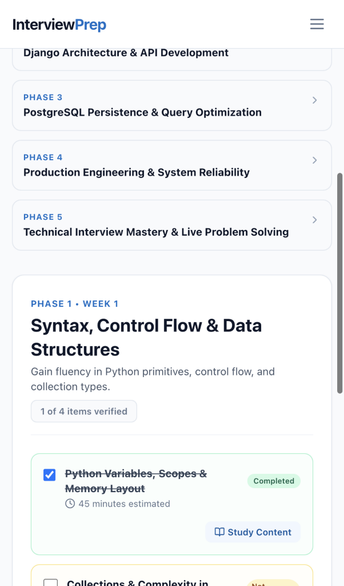
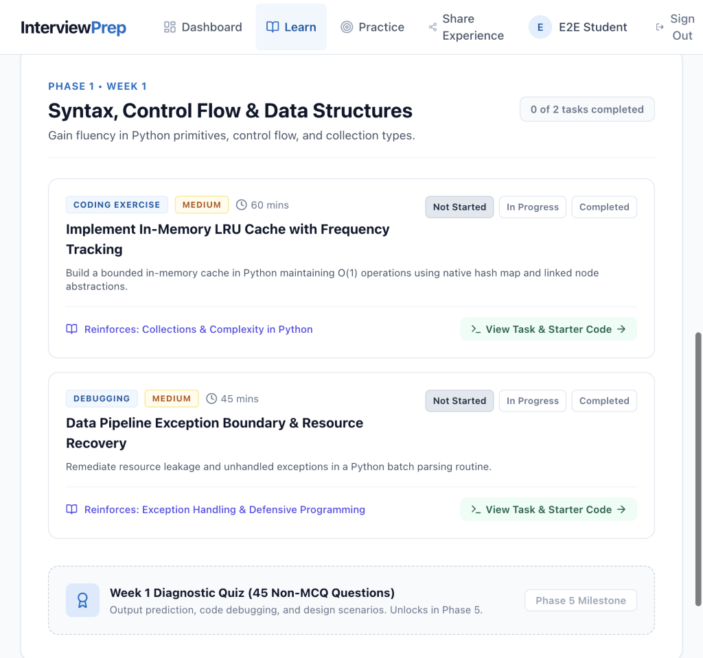
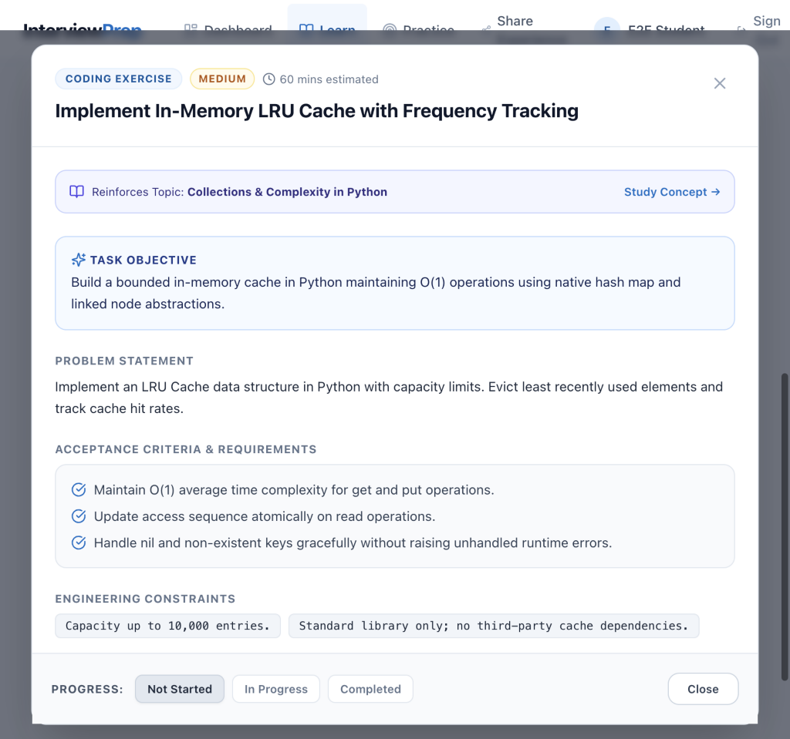
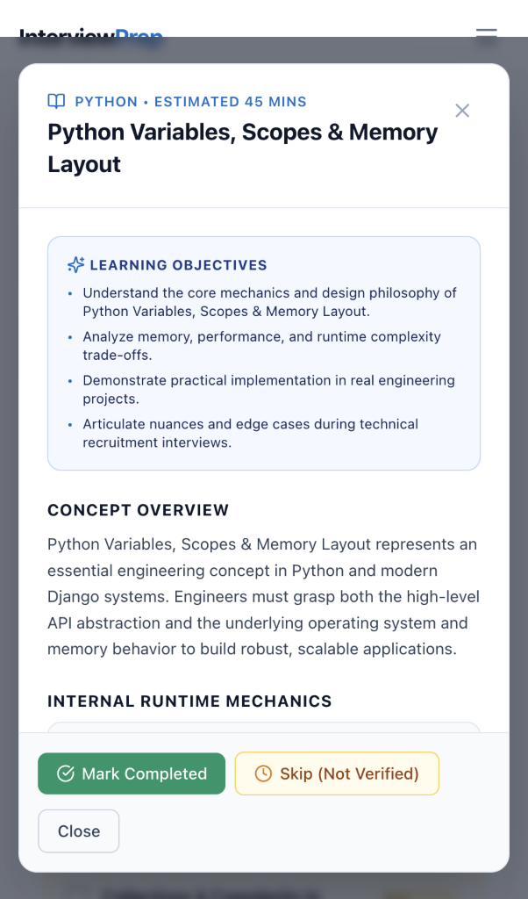
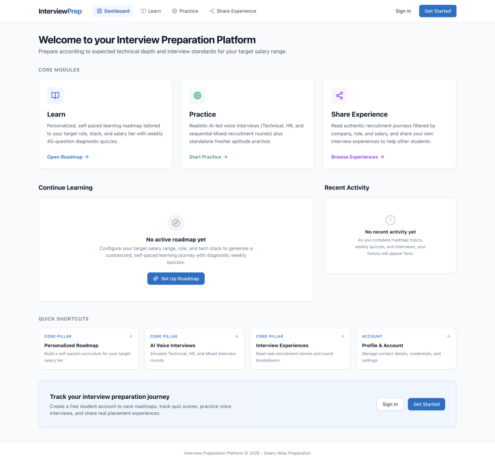
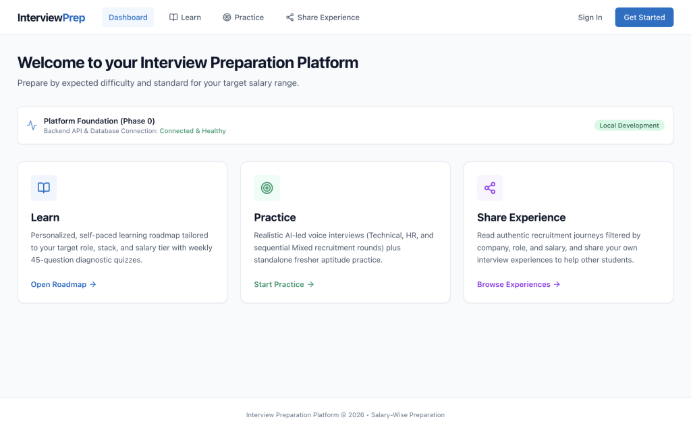

# Interview Preparation Platform (InterviewPrep)

[](backend/apps/administration/tests/)
[](frontend/e2e/)
[](https://www.python.org/)
[](https://www.djangoproject.com/)
[](https://react.dev/)
[](https://tailwindcss.com/)
[](#20-license)

> **A salary-wise, non-company-centric technical interview preparation platform and career intelligence ecosystem.**

---

## Table of Contents
1. [Project Title](#1-project-title)
2. [Project Overview](#2-project-overview)
3. [Problem Statement](#3-problem-statement)
4. [Project Objectives](#4-project-objectives)
5. [Key Features](#5-key-features)
6. [Main Application Modules](#6-main-application-modules)
7. [Technology Stack](#7-technology-stack)
8. [System Architecture](#8-system-architecture)
9. [Repository Structure](#9-repository-structure)
10. [Screenshots & UI Showcase](#10-screenshots--ui-showcase)
11. [Local Installation Instructions](#11-local-installation-instructions)
12. [Environment Configuration](#12-environment-configuration)
13. [Database Setup & Migrations](#13-database-setup--migrations)
14. [Startup Commands](#14-startup-commands)
15. [Automated Testing](#15-automated-testing)
16. [Interactive API Documentation](#16-interactive-api-documentation)
17. [Development Status & Implementation Roadmap](#17-development-status--implementation-roadmap)
18. [Future Deployment Strategy](#18-future-deployment-strategy)
19. [Contributing](#19-contributing)
20. [License](#20-license)

---

## 1. Project Title
**Interview Preparation Platform** (Branded in UI & Communications as **InterviewPrep**).

---

## 2. Project Overview
**InterviewPrep** is a web-based interview preparation and recruitment simulation platform built specifically for engineering students and early-career developers. 

Unlike traditional interview portals that force students to prepare for specific company names (e.g. company-specific test guides), **InterviewPrep focuses on salary-oriented competence tiers**. The expected depth, rigor, and technical interview expectations correlate directly with the target salary band (e.g., Below ₹3 LPA, ₹3–5 LPA, ₹5–7 LPA, ₹7–10 LPA, ₹10–15 LPA, ₹15+ LPA) rather than corporate branding.

The platform provides a unified suite comprising self-paced roadmap learning, diagnostic weekly quizzes, realistic AI-driven voice interview simulations, aptitude practice, and authentic peer-contributed recruitment experiences.

---

## 3. Problem Statement
Technical recruitment preparation in higher education faces three systemic problems:
1. **The "Company Tag" Fallacy:** Students study company-specific trivia rather than mastering the foundational engineering standards expected at their target compensation level.
2. **Passive Video & MCQ Memorization:** Multiple-choice questions do not test engineering competency. Real recruitment interviews require debugging, code tracing, scenario explanation, and verbal articulation.
3. **Fragmented Preparation Ecosystem:** Students currently bounce between separate tools for roadmaps, coding practice, aptitude preparation, mock interviews, and anonymous forums, with zero cross-module continuity.

---

## 4. Project Objectives
- **Standardize Preparation by Compensation Tiers:** Align learning curricula and evaluation criteria with realistic industry salary benchmarks.
- **Enforce Practical, Non-MCQ Diagnostics:** Deliver 45-question weekly quizzes consisting of output prediction, code debugging, practical implementation, and architectural scenarios.
- **Simulate Real AI Voice Interviews:** Conduct realistic Technical, HR, and sequential Mixed interview rounds with dynamic follow-up questioning and actionable rubrics.
- **Crowdsource Verified Experiences:** Empower students to share detailed recruitment rounds, compensation packages, and interview questions with automated risk moderation.
- **Zero-Cost Architectural Viability:** Maintain a high-performance modular monolithic architecture capable of running in resource-constrained environments without paid external dependencies.

---

## 5. Key Features
- **Student Authentication & User Management:**
  - Registration with full name, email normalization, and secure password hashing.
  - Salted SHA-256 6-digit email verification codes with 15-minute expiry, 5-attempt brute-force protection, and 60-second resend cooldowns.
  - JWT session lifecycle with automatic token rotation, blacklist invalidation on logout and password reset.
  - Timing-safe password reset workflows.
  - Student profile management (name updates, email change with two-step verification, password change with re-authentication, and explicit soft account deletion).
  - Invitation-only Administrator access with mandatory 2-Factor Authentication (2FA).
- **Personalized Learning Roadmaps:** Role, stack, and salary-tier tailored learning paths with weekly milestones.
- **Diagnostic Weekly Quizzes:** 45 non-MCQ questions (10 output prediction, 10 debugging, 10 coding, 10 scenario, 5 conceptual) with a strict 75-minute timer and asynchronous grading.
- **Generic Aptitude Practice:** Fresher cognitive foundation assessments (45 MCQs: 15 Quantitative, 15 Logical, 15 Verbal) in 60 minutes with 5 sessions/day limit and step-by-step mathematical reasoning.
- **AI-Powered Voice Interview Simulator:** Voice-to-voice interview rounds with adaptive follow-ups, silence detection, binary PASS/FAIL verdicts, and independent 24-hour cooling periods.
- **Share Interview Experience Module:** Stage-by-stage peer recruitment journeys, flexible journey builder, anonymous publishing, risk-based policy auto-moderation, community helpful votes/reports, and extraction of questions into the Learn module.

---

## 6. Main Application Modules
The platform is organized around three completely independent, equal pillars:

```
                               ┌────────────────────────────────────────┐
                               │   InterviewPrep Platform Foundation    │
                               └───────────────────┬────────────────────┘
                                                   │
                   ┌───────────────────────────────┼───────────────────────────────┐
                   ▼                               ▼                               ▼
       ┌──────────────────────┐        ┌──────────────────────┐        ┌──────────────────────┐
       │     1. LEARN         │        │    2. PRACTICE       │        │ 3. SHARE EXPERIENCE  │
       ├──────────────────────┤        ├──────────────────────┤        ├──────────────────────┤
       │ • Personalized Paths │        │ • AI Voice Interview │        │ • Real Student Exps  │
       │ • Role & Salary Tier │        │ • Tech / HR / Mixed  │        │ • Company & Package  │
       │ • Concept Deep-Dives │        │ • Cognitive Aptitude │        │ • Round Breakdown    │
       │ • 45-Q Weekly Quiz   │        │ • Real-time Rubrics  │        │ • Risk Moderation    │
       └──────────────────────┘        └──────────────────────┘        └──────────────────────┘
```

1. **Learn:** Self-paced mastery of programming languages, frameworks, system internals, and diagnostics.
2. **Practice:** High-fidelity simulation of technical rounds, behavioral HR interviews, and quantitative aptitude.
3. **Share Experience:** Transparent repository of peer interview journeys, rounds, difficulties, and questions.

---

## 7. Technology Stack

### Frontend
- **Framework:** React 18 (Strictly JavaScript ES6+, no TypeScript)
- **Tooling & Bundler:** Vite 5
- **Styling:** Tailwind CSS & shadcn/ui design tokens
- **Routing:** React Router DOM v6
- **HTTP Client:** Axios (configured with base URLs and JWT interceptors)
- **Icons:** Lucide React
- **Testing:** Playwright (Chromium/Chrome end-to-end automation)

### Backend
- **Language:** Python 3.14+
- **Framework:** Django 5.1 & Django REST Framework (DRF) 3.15
- **Authentication:** DRF SimpleJWT with token blacklisting
- **API Documentation:** drf-spectacular (OpenAPI 3.0 / Swagger UI)
- **Configuration Management:** python-decouple
- **Testing:** pytest, pytest-django, and Ruff for static analysis

### Database & Storage
- **Primary Database:** PostgreSQL 18.4 (Local port `5433` in development; standard port `5432` in production)
- **Async Execution:** Database-backed Job Ledger (`common.ProcessingJob`) with status tracking and lease timeouts (eliminates Celery/Redis in initial phase)

---

## 8. System Architecture
The application uses a **Modular Monolith** architecture. The codebase is organized into focused Django domain applications with isolated responsibilities:

```
backend/
├── config/                  # Django project root, settings, URLs, WSGI
└── apps/
    ├── common/              # Shared models, ProcessingJob table, standard response envelopes
    ├── accounts/            # Custom User, Auth, Verification, JWT, 2FA, Profiles
    ├── learning/            # Roadmap generation, catalog, milestone tracking
    ├── content/             # Topic content, exercise definitions, versioning
    ├── questions/           # Question bank, categorization, test cases
    ├── quizzes/             # Weekly 45-Q non-MCQ quiz engine, timer, evaluation
    ├── aptitude/            # Fresher cognitive aptitude practice sessions
    ├── interviews/          # AI simulation sessions, round state machines
    ├── experiences/         # Student interview stories, draft editor, moderation
    ├── administration/      # Internal analytics, invite-only admin management
    └── ai_services/         # Gemini API adapters with local fallback mock providers
```

---

## 9. Repository Structure

```
interviewprep/
├── .gitignore               # Strict exclusion of secrets, environments, and caches
├── .env.example             # Clean environment variable template
├── CONTRIBUTING.md          # Contribution guidelines and coding conventions
├── README.md                # Primary project documentation (this file)
│
├── backend/                 # Django REST Framework backend
│   ├── .env.example         # Backend-specific environment template
│   ├── manage.py            # Django command-line runner
│   ├── pytest.ini           # pytest configuration
│   ├── requirements.txt     # Pinned Python package dependencies
│   ├── config/              # Django settings, WSGI, ASGI, and root routing
│   └── apps/                # Modular domain applications (accounts, learning, etc.)
│
├── frontend/                # Vite + React frontend application
│   ├── .env.example         # Frontend environment template
│   ├── index.html           # Single-page application root HTML
│   ├── package.json         # NPM scripts and dependencies
│   ├── tailwind.config.js   # Tailwind design tokens and themes
│   ├── vite.config.js       # Vite bundler configuration
│   ├── playwright.config.js # End-to-end testing configuration
│   ├── e2e/                 # Playwright test specs
│   └── src/                 # React source code (components, features, router)
│
└── documentation/           # Complete 16-document engineering blueprint
    ├── ARCHITECTURE.md      # Detailed system architecture design
    ├── DATABASE_SCHEMA.md   # PostgreSQL schema relationships
    ├── API_DOCUMENTATION.md # API response contracts and route reference
    ├── SETUP_GUIDE.md       # Step-by-step developer setup guide
    ├── TESTING_REPORT.md    # Verified test results and metrics
    └── screenshots/         # Verified UI screenshots
```

---

## 10. Screenshots & UI Showcase

### Live Student Personalized Roadmap (Verified Phase 3)


### Live Hands-on Practice Roadmap (Verified Phase 3)


### Live Practice Task Details & Starter Code (Verified Phase 3)


### Live Topic Study Content (Verified Phase 3)


### Live Student Dashboard (Verified Phase 2)


### Live Landing Page (Verified Phase 0 & 1)


### Additional Module Previews (Under Development)
| Module | Preview | Status |
| :--- | :--- | :--- |
| **45-Question Quiz** | `[ 75-Minute Timed Quiz Interface Placeholder ]` | *Phase 5: Planned* |
| **Aptitude Practice** | `[ Fresher Aptitude Practice Interface Placeholder ]` | *Phase 6: Planned* |
| **AI Voice Interview** | `[ Real-time Simulation & Rubrics Placeholder ]` | *Phase 7: Planned* |
| **Share Experience** | `[ Experience Editor & Story Feed Placeholder ]` | *Phase 8: Planned* |

---

## 11. Local Installation Instructions

### Prerequisites
- **Python:** 3.14+ (or Python 3.11/3.12)
- **Node.js:** v20+ or v24+
- **PostgreSQL:** 15+ (Local development currently uses PostgreSQL 18.4 on port `5433`)
- **Git**

### Clone Repository
```bash
git clone https://github.com/aayushbhakare/interviewprep.git
cd interviewprep
```

---

## 12. Environment Configuration

1. **Root & Backend Environment:**
   ```bash
   cp .env.example .env
   cp .env.example backend/.env
   ```
2. **Frontend Environment:**
   ```bash
   cp frontend/.env.example frontend/.env
   ```

*Key values inside `.env`:*
```ini
DEBUG=True
SECRET_KEY=local-dev-secret-key-change-in-production
DB_NAME=interview_platform
DB_USER=your_postgres_user
DB_PASSWORD=your_postgres_password
DB_HOST=127.0.0.1
DB_PORT=5433
EMAIL_BACKEND=django.core.mail.backends.console.EmailBackend
```

---

## 13. Database Setup & Migrations

1. **Create PostgreSQL Databases:**
   ```sql
   CREATE DATABASE interview_platform;
   CREATE DATABASE test_interview_platform;
   ```
2. **Set up Python Virtual Environment:**
   ```bash
   cd backend
   python3 -m venv .venv
   source .venv/bin/activate
   pip install -r requirements.txt
   ```
3. **Execute Migrations:**
   ```bash
   python manage.py migrate
   ```
4. **Bootstrap Initial Administrator:**
   ```bash
   python manage.py bootstrap_admin --email admin@interviewprep.local --name "Platform Admin" --password "AdminPass@2026!"
   ```

---

## 14. Startup Commands

### Run Backend Server
```bash
cd backend
source .venv/bin/activate
python manage.py runserver 127.0.0.1:8000
```

### Run Frontend Dev Server
```bash
cd frontend
npm install
npm run dev -- --host 127.0.0.1 --port 5173
```

- Web Interface: [http://127.0.0.1:5173](http://127.0.0.1:5173)
- Backend API: [http://127.0.0.1:8000/api/v1/health/](http://127.0.0.1:8000/api/v1/health/)

---

## 15. Automated Testing

All tests must pass before merging code.

### Backend Automated Tests (pytest)
```bash
cd backend
source .venv/bin/activate
pytest -v
```
*Current test suite: **108 / 108 passed**.*

### Backend Linter & System Check
```bash
cd backend
ruff check config apps
python manage.py check
```

### Frontend Lint & Production Build
```bash
cd frontend
npm run lint
npm run build
```

### Frontend End-to-End Tests (Playwright)
```bash
cd frontend
npx playwright test
```
*Current test suite: **22 / 22 passed**.*

---

## 16. Interactive API Documentation

Interactive OpenAPI 3.0 documentation is automatically generated by `drf-spectacular`.

When the backend is running, visit:
- **Swagger UI:** [http://127.0.0.1:8000/api/v1/docs/](http://127.0.0.1:8000/api/v1/docs/)
- **Raw OpenAPI Schema (YAML):** [http://127.0.0.1:8000/api/v1/schema/](http://127.0.0.1:8000/api/v1/schema/)

---

## 17. Core Platform Modules

| Module | Core Deliverables | Architecture Highlights |
| :--- | :--- | :--- |
| **Authentication & Users** | Email code verification, JWT tokens, profile management, admin 2FA, soft deletion | Custom user model, token blacklisting, timing-safe verification |
| **Main Dashboard & Navigation** | Student overview, learning progress, recent activity, direct module access | Responsive dashboard shell, dark/light theme tokens |
| **Learn & Roadmaps** | Tiered learning paths, topic deep-dives, transactional milestones | Dynamic curriculum engine, salary-band alignment |
| **Shared Question Bank & Quizzes** | 45-question diagnostic assessments, 75-minute timer, offline auto-grading | Automated evaluation engine, zero-MCQ practical questions |
| **Cognitive Aptitude Practice** | Timed assessments (Quant, Logical, Verbal), 60-minute sessions, daily quotas | Step-by-step mathematical reasoning, instant scorecards |
| **AI Voice Interview Simulator** | Technical, HR, and Mixed interview sessions with real-time feedback | Web Speech API integration, adaptive turns, PASS/FAIL rubrics |
| **Interview Experience Sharing** | Peer recruitment stories, salary data, round breakdown, question bank linking | Automated policy moderation, community voting, anonymous publishing |
| **Administration Console** | Centralized management, student governance, telemetry, model configuration | Role-based permissions, audit logging, system health metrics |
| **System Hardening & Release** | End-to-end regression suite, Docker containerization, security audit | Multi-stage Docker builds, Nginx SPA routing, zero-warning deployment |

---

## 18. Future Deployment Strategy
The platform is designed to be easily deployed to containerized and serverless environments:
- **Backend:** Gunicorn WSGI container behind an Nginx reverse proxy or cloud runner (Render / Railway / Fly.io / AWS ECS).
- **Frontend:** Static distribution via Cloudflare Pages, Netlify, or Vercel.
- **Database:** Managed PostgreSQL (e.g. Supabase, Neon, AWS RDS).
- **Asynchronous Jobs:** Initially handled via Django `ProcessingJob` polling; architected for easy migration to Celery/Redis as volume scales.
- **Object Storage:** Adapter-ready for Supabase Storage or Cloudflare R2 for resume snapshots and audio recordings.

---

## 19. Contributing
Contributions are welcome! Please review [CONTRIBUTING.md](CONTRIBUTING.md) for details regarding our architectural constraints, coding standards, and pull request procedures.

---

## 20. License
*No license has yet been explicitly selected.* 

All rights are currently reserved by the repository owner. An open-source license (such as MIT, Apache 2.0, or AGPLv3) will be selected and added to this repository prior to formal public release.
