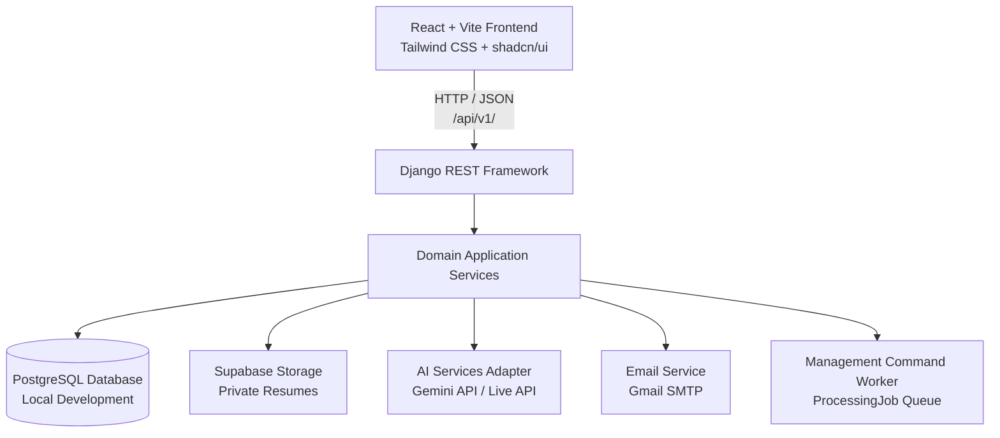

# Architecture Documentation

## System Architecture

The Interview Preparation Platform is designed as a **Modular Monolith** containing:
- A single Django backend exposing versioned REST APIs (`/api/v1/`).
- A React + Vite frontend written in JavaScript with Tailwind CSS and shadcn/ui.
- A local PostgreSQL database as the primary source of truth.
- Decoupled external provider adapters (Gemini AI, Supabase Storage, Gmail SMTP).



## Domain Apps (Backend)

1. **`accounts`**: Custom User model (email login), UserProfile, authentication tokens (SimpleJWT), verification codes, password reset, and admin 2FA.
2. **`learning`**: Active roadmap, roadmap configuration snapshots, phases, weeks, topic progress tracking, and transactional replacement.
3. **`content`**: Versioned topic content, concept explanations, and practical exercises.
4. **`questions`**: Shared question bank, versioning, AI validation records, reports, and exposure tracking.
5. **`quizzes`**: Weekly quiz assignments (45 questions), timer enforcement, immutable attempt snapshots, answers, and evaluations.
6. **`aptitude`**: Shared aptitude question bank, sessions, daily attempt limits, scoring, and Mixed qualifying thresholds.
7. **`interviews`**: Voice interview sessions, rounds, round-level and overall PASS/FAIL outcomes, cooling period enforcement, and resume snapshot references.
8. **`experiences`**: Student interview journeys, drafts, stages, anonymous/public authoring, risk-based moderation, discovery, and reports.
9. **`administration`**: System settings, admin activity audit logs, and maintenance toggles.
10. **`ai_services`**: Provider adapters, prompts, structured output validation, token usage tracking, and cost accounting.
11. **`common`**: Reusable models (timestamps, UUIDs), utilities, error envelopes, and `ProcessingJob` async queue.

## Frontend Organization

```text
frontend/src/
├── app/
│   ├── router/          # React Router route definitions
│   └── providers/       # AuthProvider, ThemeProvider, ToastProvider
├── components/
│   ├── ui/              # shadcn/ui primitives (Button, Dialog, Input, etc.)
│   └── shared/          # Navbar, Footer, LoadingSpinners, ErrorBoundary
├── features/
│   ├── auth/            # Login, Register, Verify, Reset
│   ├── dashboard/       # Student Dashboard & Overview
│   ├── learning/        # Roadmap Setup Wizard, Roadmap Viewer, Topic Content
│   ├── quizzes/         # 45-Question Quiz UI, Timer, Palette, Review
│   ├── aptitude/        # Aptitude Test UI, Palette, History
│   ├── practice/        # Voice Interview Room, Microphone Controls, Feedback
│   ├── experiences/     # Journey Editor, Discovery, Filters, Report
│   └── admin/           # All 11 Admin Panel Sections
├── services/            # Axios API client instances and endpoint modules
├── hooks/               # Custom React hooks
├── contexts/            # Context definitions
└── layouts/             # StudentLayout, AdminLayout, AuthLayout
```
