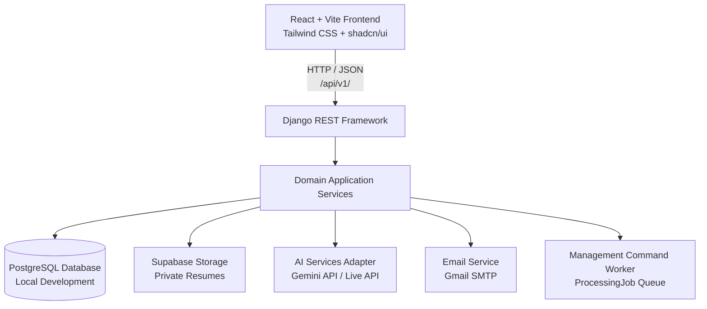

# Architecture Documentation

## System Architecture

The Interview Preparation Platform is designed as a **Modular Monolith** containing:
- A single Django backend exposing versioned REST APIs (`/api/v1/`).
- A React + Vite frontend written in JavaScript with Tailwind CSS and shadcn/ui.
- A local PostgreSQL database as the primary source of truth.
- Decoupled external provider adapters (Gemini AI, Supabase Storage, Gmail SMTP).



## Domain Apps (Backend)

1. **`accounts`**: Custom User model (email login), UserProfile, authentication tokens (SimpleJWT), verification codes, password reset, and admin 2FA.
2. **`learning`**: Active roadmap, roadmap configuration snapshots, phases, weeks, topic progress tracking, hands-on practice roadmap, practice task progress, and transactional replacement.
3. **`content`**: Versioned topic content, concept explanations, and practical exercises.
4. **`questions`**: Shared question bank, versioning, AI validation records (`QuestionValidationHistory`), student reports, and admin management.
5. **`quizzes`**: Weekly quiz assignments (45 questions), 75-minute timer enforcement, question version snapshotting, autosave, binary evaluation engine (Correct/Incorrect), and attempt history.
6. **`aptitude`**: Shared aptitude question bank, sessions, daily attempt limits, scoring, and Mixed qualifying thresholds.
7. **`interviews`**: Voice interview sessions, rounds, round-level and overall PASS/FAIL outcomes, cooling period enforcement, and resume snapshot references.
8. **`experiences`**: Student interview journeys, drafts, stages, anonymous/public authoring, risk-based moderation, discovery, and reports.
9. **`administration`**: System settings, admin activity audit logs, and maintenance toggles.
10. **`ai_services`**: Provider adapters, prompts, structured output validation, token usage tracking, and cost accounting.
11. **`common`**: Reusable models (timestamps, UUIDs), utilities, error envelopes, and `ProcessingJob` async queue.

## Question Bank & Weekly Quiz Architecture

### Question Bank & Validation Pipeline (`apps/questions`)
- **Strict Non-MCQ Categories:** Questions are strictly categorized into 5 formats: Code Output Prediction, Find Error / Debugging, Coding Problems, Scenario-Based Architecture, Conceptual / Short Answer. Multiple-choice questions (MCQs) are prohibited.
- **Entity vs Version Segregation:** The `Question` model represents the canonical identity of a question (technology, topic, category, difficulty, status). The `QuestionVersion` model stores immutable content snapshots (prompt, code snippet, expected answer, explanation, version number, created timestamp).
- **Automated Validation & 3-Attempt Revision Loop:** New AI-generated questions undergo structural schema checks (prompt length, code snippet presence for debugging/output, expected answer completeness). Failing questions trigger an automated revision prompt up to 3 times before being marked as `Suspended – Review Failed` with logged failure diagnostics in `QuestionValidationHistory`.
- **Deterministic Offline Fallback:** A local deterministic engine generates curated questions with zero API calls, ensuring high test performance and zero financial cost.

### Weekly Quiz Lifecycle (`apps/quizzes`)
- **Strict 45-Question Distribution:** Each roadmap week assignment prepares exactly 45 questions: 10 Output, 10 Debugging, 10 Coding, 10 Scenario, and 5 Conceptual questions, prioritizing previously unseen questions from the bank.
- **Session Management & Countdown Timer:** The 75-minute timer is calculated on the server from `started_at` timestamp. Client-side timer displays the countdown while server endpoints enforce the limit (+60s network latency buffer).
- **Debounced Autosave & Persistence:** User answers are persisted to `AttemptAnswer` via debounced API calls, preserving progress across browser reloads or tab closures.
- **Abandonment vs Submission:** Leaving an active quiz discards current attempt answers without consuming one of the 5 allowed submitted attempts. Submitting permanently locks answers and increments the submission count.
- **Binary Evaluation Engine:** Answers are strictly evaluated as Correct or Incorrect. No partial credit is awarded. Score equals `(Correct / 45) * 100`. Failed evaluations transition to `Evaluation Pending` with a background `ProcessingJob` retry mechanism. Retakes are blocked while evaluation is pending.
- **Milestone Increment:** Submitting a weekly quiz increments the roadmap week's completed milestones counter by exactly 1. Retakes do not award duplicate milestone credit.

## Aptitude Practice Architecture (Phase 5)

### Shared Cognitive Question Bank (`apps/aptitude`)
- **Standardized Cognitive Assessment Reference:** Standardized on prevailing campus recruitment cognitive foundation patterns (practice baseline: 45 questions, 60 mins: 15 Quantitative Aptitude, 15 Logical Reasoning, 15 Verbal Ability).
- **Strict 4-Option MCQ Format:** In direct contrast to non-MCQ technical quizzes, all aptitude items are 4-option multiple-choice questions (A, B, C, D) with exactly one mathematically or logically valid correct option.
- **Entity vs Version Segregation:** Canonical identity (`AptitudeQuestion`) stores section, topic, difficulty, and operational status (`approved`, `suspended`, `inactive`). Immutable content versions (`AptitudeQuestionVersion`) store question text, options array, correct option index, step-by-step explanation, changelog, and creation timestamp.
- **Structured Validation & 3-Attempt Revision Loop:** AI-generated questions undergo structural schema checks (distinct non-empty options, valid correct option index, step-by-step mathematical derivation in explanation). Invalid items trigger up to 3 revisions before logging failure in `AptitudeValidationHistory` as `Suspended – Review Failed`.
- **Deterministic Offline Fallback Engine:** Guarantees ₹0 operational cost and predictable test suite execution by synthesizing curated cognitive foundation questions mathematically offline without external API dependencies.

### Fresher Eligibility Gate & Session Lifecycle
- **Fresher Experience Restriction:** Standalone aptitude practice is restricted to freshers and entry-level candidates (`"Fresher"`, `"Less than 1 year"`). Experienced candidates (`"1–3 years"`, `"3–5 years"`, `"5+ years"`) are blocked on backend endpoints with 403 Forbidden (`PermissionDenied`).
- **Daily Attempt Quota:** Students receive up to 5 submitted standalone sessions per calendar day. Abandoned sessions discard answers and do NOT consume attempt quota.
- **Mixed Stage Exemption & Qualification:** Aptitude stages within Phase 6 Mixed recruitment simulations do NOT consume the standalone 5/day allowance and evaluate against an admin-configurable qualifying cutoff (`mixed_qualifying_cutoff`, default 60% = PASS/FAIL).
- **No PASS/FAIL for Standalone Practice:** Standalone practice sessions **never** issue recruitment pass/fail verdicts—they serve purely as self-paced diagnostic practice with detailed step-by-step mathematical working.
- **Objective Evaluation Engine:** Deterministic MCQ grading evaluates `is_correct = (selected == correct)`. Unattempted questions receive 0 marks with 0 penalty.

## AI-Powered Interview Practice Architecture (Phase 6)

### Three Practice Tracks & Generic Standards (`apps/interviews`)
- **Strict Generic Positioning:** No company names, questions, or templates. Simulations strictly follow salary-wise and role-wise standards across Indian tech recruitment tiers (₹3–5 LPA to ₹30+ LPA).
- **Technical Track:** Deep technical interrogation covering core languages, frameworks, databases, system design, and complexity trade-offs tailored to candidate's stack.
- **HR Track:** Behavioral, situational, teamwork, conflict management, and career motivation questions without technical stack requirements.
- **Mixed Sequential Pipeline:** Multi-round recruitment simulation:
  - Freshers: Round 1 (Cognitive Aptitude Screening, 60% cutoff) -> Round 2 (Technical 1) -> Round 3 (Technical 2) -> Round 4 (HR).
  - Experienced: Round 1 (Technical 1) -> Round 2 (Technical 2) -> Round 3 (HR).
  - Gated round progression: passing Round 1 Aptitude ($\ge 60\%$) unlocks Round 2; failing aborts the pipeline with an objective `FAIL`.

### Binary Evaluation Engine & Feedback
- **Purely Binary Outcomes:** System strictly outputs `INTERVIEW PASSED` or `INTERVIEW NOT CLEARED`. No marks, numbers, or percentages are displayed.
- **Constructive Qualitative Feedback:** Six structured dimensions: Technical Knowledge, Communication, Problem Solving, Observed Weaknesses, Priority Areas to Revise, and Actionable Suggestions.

### Independent Cooling Period Engine
- **Independent Isolation:** Unsuccessful attempts trigger a 24-hour cooling period strictly per `(user, interview_type)` stored in `InterviewCoolingPeriod`.
- **Cross-Track Freedom:** Failing Technical does not prevent candidate from attempting HR or Mixed interviews. Passing or voluntarily abandoning an interview incurs 0 cooling.

### Real-Time Voice Simulation & ₹0 Budget Architecture
- **Browser Native Web Speech API:** Client-side speech recognition (STT) and synthesized speech playback (TTS) operate directly in the browser with zero external API latency and zero operational expense.
- **Interruption & Silence Detection:** Candidate speech is punctuated with 1.8-second silence detection; a manual "Interrupt Interviewer" button cancels ongoing audio synthesis instantly.
- **Provider Abstraction:** Backend `BaseInterviewProvider` interfaces with `DeterministicVoiceProvider` (100% offline predictability, ₹0 budget) and `GeminiVoiceProvider` (Gemini 2.0 Flash) with token usage metering.
- **Hardware Diagnostics PoC:** Built-in `VoicePoCModal` verifies microphone hardware, live STT recognition, and TTS playback prior to starting an interview session.
- **Resume Snapshotting:** Preserves an immutable snapshot reference to the candidate's active `UserResumeVersion` at session creation time.

## Share Interview Experience Architecture (Phase 7)

### Permitted Company Attribution Policy (`apps/experiences`)
- **Single Permitted Company Space:** While Learn, Practice, Weekly Quizzes, Aptitude Tests, and AI Mock Interviews remain strictly salary-wise and role-wise, the Share Interview Experience module is the only module where company names are collected and displayed.
- **Transparent Peer Insights:** Permits students to document and discover authentic recruitment pipelines with company context without converting the platform into a company-specific prep tool.

### Flexible Recruitment Journey Builder
- **Non-Rigid Sequence:** Candidates structure their journeys across any arbitrary combination of stages: Application & Resume Screening, Online Aptitude Test, Technical Rounds 1/2/3, Managerial Round, HR & Culture Discussion, Offer Negotiation, or Custom stages.
- **Granular Question & Strategy Documenter:** Captures exact interviewer prompts, follow-up twists, interviewer expectations, and candidate response logic.
- **Anonymous vs Named Identity:** Toggleable anonymous publishing masks the author's public profile as "Anonymous Candidate" while retaining verified ownership internally.

### Deterministic Risk-Based Moderation Engine (`experiences_moderation_service.py`)
- **Automated Content Scanning:** Evaluates submissions for:
  - PII (phone numbers, email addresses, Aadhaar numbers, credentials/tokens).
  - Promotional spam and suspicious URLs (Telegram channels, WhatsApp groups, bit.ly links).
  - Profanity and defamatory attacks.
  - Structural completeness (company, role, outcome, minimum 1 stage).
- **Three-Tier Policy Enforcement:**
  - `Low Risk`: Auto-published immediately to public discovery (`published_version` increments).
  - `Medium / High Risk`: Flagged and queued for administrator review (`status = pending_review`).
  - `Structural Failure`: Rejected with specific corrective feedback (`status = rejected`).

### Safe Versioning for Published Experience Edits
- When updating an already-published experience, the approved live version remains visible on discovery to peers.
- The new revision is captured in an `ExperienceVersion` snapshot and evaluated. If approved by moderators, it replaces the canonical record; if rejected, the original version remains published.

### Question Extraction & Learn Module Integration (`question_extractor_service.py`)
- Automatically detects technologies (Python, Django, React, SQL, Java, DSA, System Design, HR) from questions in published experiences.
- Indexes active questions into `StudentReportedQuestion` and enriches `/api/v1/learning/topics/<id>/content/` with candidate-reported questions stamped with the mandatory label:
  `provenance_label: "Student Reported Interview Question"`
- Safe orphan protection ensures that deleting or suspending an experience automatically deactivates all associated questions across the platform.

### Staff Moderation & Community Reporting Console (`/admin/experiences`)
- Review queue with status filters, automated policy scanner findings, and full author identity reveal.
- Community reports tracking across 7 standardized reason categories with auto-hide trigger at 3+ distinct reports.
- Comprehensive audit trail logged to `AdminActivityLog`.

## Administration & Platform Operations Architecture (`apps/administration`)

### Security, Roles & Invitation Lifecycle
- **Permission Governance:** `IsPlatformAdmin` verifies standard Django staff identity (`is_staff=True`), active state (`is_active=True`), and absence of suspension (`is_suspended=False`). Rejects unauthenticated and student requests with HTTP 403.
- **Invitation Token Flow:** Trusted administrators create invitations with 7-day cryptographic single-use tokens. Onboarding links require token validation and 2FA setup.
- **Lockout Prevention Invariant:** Both backend transactional hooks and UI state disable deactivation when only one active administrator remains in the database.

### Centralized Admin Console Architecture
- **Single Layout Component (`AdminLayout.jsx`):** Employs responsive sidebar navigation organizing 12 administrative operational domains:
  1. *Dashboard Overview* (`/admin/dashboard`)
  2. *Student Management* (`/admin/students`)
  3. *Learning Content Versioning* (`/admin/learning`)
  4. *Technical Question Bank* (`/admin/question-bank`)
  5. *Aptitude Question Bank* (`/admin/aptitude`)
  6. *Interview Simulations* (`/admin/interviews`)
  7. *Experience Moderation* (`/admin/experiences`)
  8. *Platform Settings* (`/admin/settings`)
  9. *AI Models & Routing* (`/admin/ai-models`)
  10. *System Health & Telemetry* (`/admin/monitoring`)
  11. *Activity Audit Logs* (`/admin/activity-logs`)
  12. *Admin Security & Invitations* (`/admin/security`)

### Content Versioning & Progress Preservation
- When updating topic markdown, staff author new versions (`v = latest + 1`).
- Topic completions in `StudentTopicProgress` link to canonical `Topic` identity rather than version snapshot, ensuring candidate milestone progress remains intact across content revisions.

### Middleware & Maintenance Controls
- **`MaintenanceModeMiddleware`:** Inspects `maintenance_config` from `PlatformSetting`. Returns HTTP 503 with custom notification messages on candidate traffic. Authenticated staff users are strictly exempt from maintenance blocks to enable ongoing verification.
- **`AccountSuspensionMiddleware`:** Enforces instant access termination on suspended students across all candidate endpoints while allowing logout.

## Coding Standards & Review Architecture

### Permanent Engineering Standards
- **Natural, Professional Code Style:** Avoid decorative comment banners, ASCII art headers, and obvious comments that restate code syntax. Keep docstrings and comments focused on non-obvious business logic, domain invariants, and security-critical rules.
- **Consistent Layering:**
  - Views handle HTTP deserialization, schema contracts (`drf-spectacular`), and dispatch.
  - Domain services (`apps/<domain>/services/`) encapsulate business logic, transactional operations, and security rules.
  - Models manage data schemas, foreign keys, and direct table constraints.
- **Frontend Practices:** Pure React 18 in JavaScript (ES6+ JSX, no TypeScript). Centralized routing with `ProtectedRoute` guards and standard Axios interceptors.

### CodeRabbit Automated Review Architecture
- Repository-level configuration in `.coderabbit.yaml`.
- Enforces strict review gates on every phase branch PR before merging into `main`.
- Validates modular monolith boundaries, absence of unauthorized Celery/Redis dependencies, correct Django migration coverage, and responsive UX states.


```text
frontend/src/
├── app/
│   ├── router/          # React Router route definitions
│   └── providers/       # AuthProvider, ThemeProvider, ToastProvider
├── components/
│   ├── ui/              # shadcn/ui primitives (Button, Dialog, Input, etc.)
│   └── shared/          # Navbar, Footer, LoadingSpinners, ErrorBoundary
├── features/
│   ├── auth/            # Login, Register, Verify, Reset
│   ├── dashboard/       # Student Dashboard & Overview
│   ├── learning/        # Roadmap Setup Wizard, Roadmap Viewer, Topic Content
│   ├── quizzes/         # 45-Question Quiz UI, Timer, Palette, Review
│   ├── aptitude/        # Aptitude Test UI, Palette, History
│   ├── practice/        # Voice Interview Room, Microphone Controls, Feedback
│   ├── experiences/     # Journey Editor, Discovery, Filters, Report
│   └── admin/           # All 11 Admin Panel Sections
├── services/            # Axios API client instances and endpoint modules
├── hooks/               # Custom React hooks
├── contexts/            # Context definitions
└── layouts/             # StudentLayout, AdminLayout, AuthLayout
```
