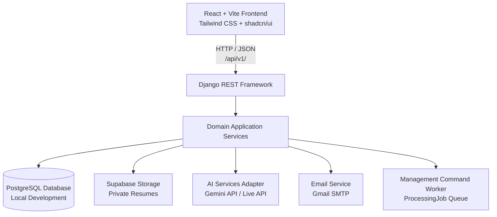

# Architecture Documentation

## System Architecture

The Interview Preparation Platform is designed as a **Modular Monolith** containing:
- A single Django backend exposing versioned REST APIs (`/api/v1/`).
- A React + Vite frontend written in JavaScript with Tailwind CSS and shadcn/ui.
- A local PostgreSQL database as the primary source of truth.
- Decoupled external provider adapters (Gemini AI, Supabase Storage, Gmail SMTP).



## Domain Apps (Backend)

1. **`accounts`**: Custom User model (email login), UserProfile, authentication tokens (SimpleJWT), verification codes, password reset, and admin 2FA.
2. **`learning`**: Active roadmap, roadmap configuration snapshots, phases, weeks, topic progress tracking, hands-on practice roadmap, practice task progress, and transactional replacement.
3. **`content`**: Versioned topic content, concept explanations, and practical exercises.
4. **`questions`**: Shared question bank, versioning, AI validation records (`QuestionValidationHistory`), student reports, and admin management.
5. **`quizzes`**: Weekly quiz assignments (45 questions), 75-minute timer enforcement, question version snapshotting, autosave, binary evaluation engine (Correct/Incorrect), and attempt history.
6. **`aptitude`**: Shared aptitude question bank, sessions, daily attempt limits, scoring, and Mixed qualifying thresholds.
7. **`interviews`**: Voice interview sessions, rounds, round-level and overall PASS/FAIL outcomes, cooling period enforcement, and resume snapshot references.
8. **`experiences`**: Student interview journeys, drafts, stages, anonymous/public authoring, risk-based moderation, discovery, and reports.
9. **`administration`**: System settings, admin activity audit logs, and maintenance toggles.
10. **`ai_services`**: Provider adapters, prompts, structured output validation, token usage tracking, and cost accounting.
11. **`common`**: Reusable models (timestamps, UUIDs), utilities, error envelopes, and `ProcessingJob` async queue.

## Question Bank & Weekly Quiz Architecture

### Question Bank & Validation Pipeline (`apps/questions`)
- **Strict Non-MCQ Categories:** Questions are strictly categorized into 5 formats: Code Output Prediction, Find Error / Debugging, Coding Problems, Scenario-Based Architecture, Conceptual / Short Answer. Multiple-choice questions (MCQs) are prohibited.
- **Entity vs Version Segregation:** The `Question` model represents the canonical identity of a question (technology, topic, category, difficulty, status). The `QuestionVersion` model stores immutable content snapshots (prompt, code snippet, expected answer, explanation, version number, created timestamp).
- **Automated Validation & 3-Attempt Revision Loop:** New AI-generated questions undergo structural schema checks (prompt length, code snippet presence for debugging/output, expected answer completeness). Failing questions trigger an automated revision prompt up to 3 times before being marked as `Suspended – Review Failed` with logged failure diagnostics in `QuestionValidationHistory`.
- **Deterministic Offline Fallback:** A local deterministic engine generates curated questions with zero API calls, ensuring high test performance and zero financial cost.

### Weekly Quiz Lifecycle (`apps/quizzes`)
- **Strict 45-Question Distribution:** Each roadmap week assignment prepares exactly 45 questions: 10 Output, 10 Debugging, 10 Coding, 10 Scenario, and 5 Conceptual questions, prioritizing previously unseen questions from the bank.
- **Session Management & Countdown Timer:** The 75-minute timer is calculated on the server from `started_at` timestamp. Client-side timer displays the countdown while server endpoints enforce the limit (+60s network latency buffer).
- **Debounced Autosave & Persistence:** User answers are persisted to `AttemptAnswer` via debounced API calls, preserving progress across browser reloads or tab closures.
- **Abandonment vs Submission:** Leaving an active quiz discards current attempt answers without consuming one of the 5 allowed submitted attempts. Submitting permanently locks answers and increments the submission count.
- **Binary Evaluation Engine:** Answers are strictly evaluated as Correct or Incorrect. No partial credit is awarded. Score equals `(Correct / 45) * 100`. Failed evaluations transition to `Evaluation Pending` with a background `ProcessingJob` retry mechanism. Retakes are blocked while evaluation is pending.
- **Milestone Increment:** Submitting a weekly quiz increments the roadmap week's completed milestones counter by exactly 1. Retakes do not award duplicate milestone credit.

## Aptitude Practice Architecture (Phase 5)

### Shared Cognitive Question Bank (`apps/aptitude`)
- **Standardized Cognitive Assessment Reference:** Standardized on prevailing campus recruitment cognitive foundation patterns (practice baseline: 45 questions, 60 mins: 15 Quantitative Aptitude, 15 Logical Reasoning, 15 Verbal Ability).
- **Strict 4-Option MCQ Format:** In direct contrast to non-MCQ technical quizzes, all aptitude items are 4-option multiple-choice questions (A, B, C, D) with exactly one mathematically or logically valid correct option.
- **Entity vs Version Segregation:** Canonical identity (`AptitudeQuestion`) stores section, topic, difficulty, and operational status (`approved`, `suspended`, `inactive`). Immutable content versions (`AptitudeQuestionVersion`) store question text, options array, correct option index, step-by-step explanation, changelog, and creation timestamp.
- **Structured Validation & 3-Attempt Revision Loop:** AI-generated questions undergo structural schema checks (distinct non-empty options, valid correct option index, step-by-step mathematical derivation in explanation). Invalid items trigger up to 3 revisions before logging failure in `AptitudeValidationHistory` as `Suspended – Review Failed`.
- **Deterministic Offline Fallback Engine:** Guarantees ₹0 operational cost and predictable test suite execution by synthesizing curated cognitive foundation questions mathematically offline without external API dependencies.

### Fresher Eligibility Gate & Session Lifecycle
- **Fresher Experience Restriction:** Standalone aptitude practice is restricted to freshers and entry-level candidates (`"Fresher"`, `"Less than 1 year"`). Experienced candidates (`"1–3 years"`, `"3–5 years"`, `"5+ years"`) are blocked on backend endpoints with 403 Forbidden (`PermissionDenied`).
- **Daily Attempt Quota:** Students receive up to 5 submitted standalone sessions per calendar day. Abandoned sessions discard answers and do NOT consume attempt quota.
- **Mixed Stage Exemption & Qualification:** Aptitude stages within Phase 6 Mixed recruitment simulations do NOT consume the standalone 5/day allowance and evaluate against an admin-configurable qualifying cutoff (`mixed_qualifying_cutoff`, default 60% = PASS/FAIL).
- **No PASS/FAIL for Standalone Practice:** Standalone practice sessions **never** issue recruitment pass/fail verdicts—they serve purely as self-paced diagnostic practice with detailed step-by-step mathematical working.
- **Objective Evaluation Engine:** Deterministic MCQ grading evaluates `is_correct = (selected == correct)`. Unattempted questions receive 0 marks with 0 penalty.

## Coding Standards & Review Architecture

### Permanent Engineering Standards
- **Natural, Professional Code Style:** Avoid decorative comment banners, ASCII art headers, and obvious comments that restate code syntax. Keep docstrings and comments focused on non-obvious business logic, domain invariants, and security-critical rules.
- **Consistent Layering:**
  - Views handle HTTP deserialization, schema contracts (`drf-spectacular`), and dispatch.
  - Domain services (`apps/<domain>/services/`) encapsulate business logic, transactional operations, and security rules.
  - Models manage data schemas, foreign keys, and direct table constraints.
- **Frontend Practices:** Pure React 18 in JavaScript (ES6+ JSX, no TypeScript). Centralized routing with `ProtectedRoute` guards and standard Axios interceptors.

### CodeRabbit Automated Review Architecture
- Repository-level configuration in `.coderabbit.yaml`.
- Enforces strict review gates on every phase branch PR before merging into `main`.
- Validates modular monolith boundaries, absence of unauthorized Celery/Redis dependencies, correct Django migration coverage, and responsive UX states.


```text
frontend/src/
├── app/
│   ├── router/          # React Router route definitions
│   └── providers/       # AuthProvider, ThemeProvider, ToastProvider
├── components/
│   ├── ui/              # shadcn/ui primitives (Button, Dialog, Input, etc.)
│   └── shared/          # Navbar, Footer, LoadingSpinners, ErrorBoundary
├── features/
│   ├── auth/            # Login, Register, Verify, Reset
│   ├── dashboard/       # Student Dashboard & Overview
│   ├── learning/        # Roadmap Setup Wizard, Roadmap Viewer, Topic Content
│   ├── quizzes/         # 45-Question Quiz UI, Timer, Palette, Review
│   ├── aptitude/        # Aptitude Test UI, Palette, History
│   ├── practice/        # Voice Interview Room, Microphone Controls, Feedback
│   ├── experiences/     # Journey Editor, Discovery, Filters, Report
│   └── admin/           # All 11 Admin Panel Sections
├── services/            # Axios API client instances and endpoint modules
├── hooks/               # Custom React hooks
├── contexts/            # Context definitions
└── layouts/             # StudentLayout, AdminLayout, AuthLayout
```
